# Hospital Readmission Prediction

A reproducible healthcare data science portfolio project using the **real UCI Diabetes 130-US Hospitals dataset**. Python 3.11 · scikit-learn · CPU XGBoost · SHAP · patient-aware validation.

> Educational retrospective modelling, not a clinically validated prediction system. No synthetic records or external dataset downloads are used.

## 1. Executive Summary

Predict recorded readmission within 30 days (`readmitted == "<30"`) at **hospital discharge**. From 101,766 source encounters, a prespecified clinical cohort retains **99,319 encounters / 69,980 patients**. Every patient's encounters remain together across holdouts and CV folds.

**XGBoost** was selected by mean **training CV average precision**, before test evaluation. On 19,861 untouched test encounters (prevalence 11.38%), its ROC-AUC was **0.6693**, average precision **0.2259**, and Brier score **0.0960**. The validation-selected threshold 0.0936 gave sensitivity **72.79%** and precision **15.82%**. Interpret discrimination, calibration and false-positive workload together.

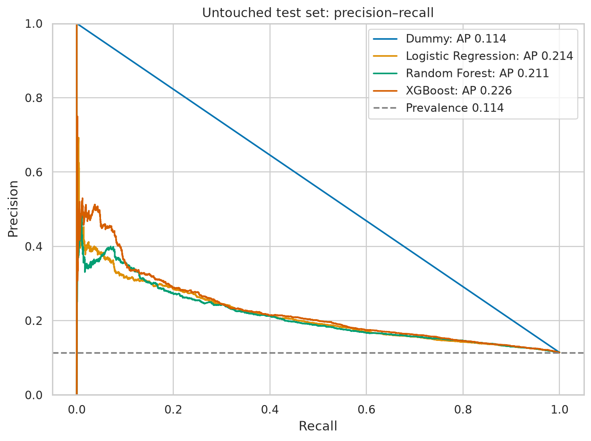

## 2. Clinical Problem and Motivation

Readmission can indicate clinical complexity, gaps in continuity and social barriers. A discharge-time risk score might support investigation of follow-up allocation. It cannot establish preventability, specify effective treatment, or replace clinical assessment. This project demonstrates reproducible analysis relevant to a UK Healthcare Data Scientist role without claiming NHS deployment or patient benefit.

The outcome is the **source's recorded `<30` label**, not an independently ascertained all-hospital outcome. `>30` and `NO` form the negative class. Encounter summaries, diagnoses and medication information are assumed available at discharge; real-time availability is not timestamp-verified.

## 3. Dataset Description and Official UCI Citation

The unchanged original archive is in `data/raw/diabetes+130-us+hospitals+for+years+1999-2008.zip`. Both `diabetic_data.csv` and `IDS_mapping.csv` are read inside the ZIP. No extraction or duplicate dataset is required.

- Raw data: **101,766 encounters, 71,518 patients, 50 columns** (47 source features, two IDs, one target).
- Raw outcomes: `<30` **11,357**, `>30` **35,545**, `NO` **54,864**.
- ZIP CRCs, exact schema, valid/unique encounter IDs, mapping coverage and SHA-256 are checked by the existing loader.
- SHA-256: `f82ac129da2ddd2299391ff6fbae3a6a58b3edcf59ac9d7bd480c00fe453112a`. This is the uploaded archive's local fingerprint, not an independently obtained official checksum. Content matches the original UCI release profile; no live-server byte comparison was performed.
- [Complete raw schema, missing-value counts and provenance](docs/dataset_reference.md); [machine-readable profile](reports/raw_dataset_profile.json).

**Dataset citation:** Clore, J., Cios, K., DeShazo, J., & Strack, B. (2014). *Diabetes 130-US Hospitals for Years 1999-2008* [Dataset]. UCI Machine Learning Repository. DOI: **[10.24432/C5230J](https://doi.org/10.24432/C5230J)**. [UCI dataset record](https://archive.ics.uci.edu/dataset/296/diabetes+130-us+hospitals+for+years+1999-2008).

**Source study:** Strack, B., et al. (2014). *Impact of HbA1c Measurement on Hospital Readmission Rates: Analysis of 70,000 Clinical Database Patient Records*. BioMed Research International, 781670. DOI: [10.1155/2014/781670](https://doi.org/10.1155/2014/781670). The dataset citation and study authorship are distinct.

**Attribution:** the dataset creators and UCI Machine Learning Repository provide the data under [CC BY 4.0](https://creativecommons.org/licenses/by/4.0/). The ZIP is redistributed unchanged. The loader normalises `?` markers and mapping-label whitespace in memory; subsequent cohort filtering, derived features and the binary label are project transformations. No endorsement by the data creators is implied.

## 4. Exploratory Data Analysis

Model-guiding EDA uses **training patients only**. It covers dtypes, descriptive statistics, missingness and co-missingness, target imbalance, demographics, admissions/discharge, previous visits, diagnosis groups and clinical characteristics. Aggregate reports omit patient identifiers.

In training data, recorded 30-day readmission was 8.6% with no prior inpatient visits and 26.2% with three or more. This is an association, not evidence that an intervention on visit counts changes risk.

`weight` has extreme missingness and is removed by the training-fitted >95% rule. `medical_specialty`, payer and diagnoses also have missing values. Literal laboratory `None` means **not measured**, separate from `?`; measurement flags preserve this distinction. Missingness may be informative and not missing at random. There are 5 constant fields in the training data; their categories carry no discriminative variation.

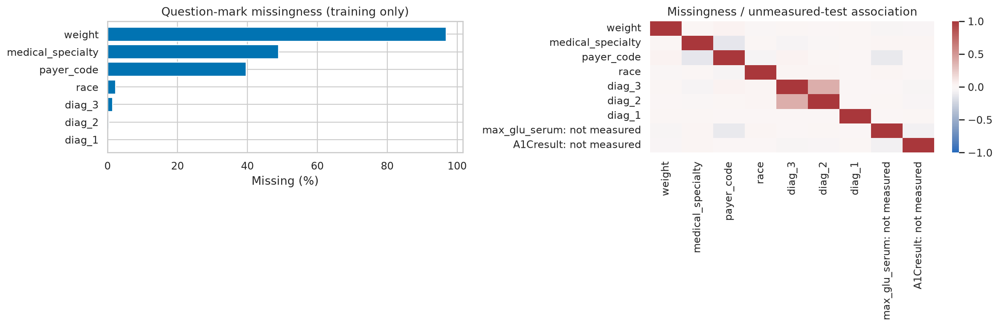
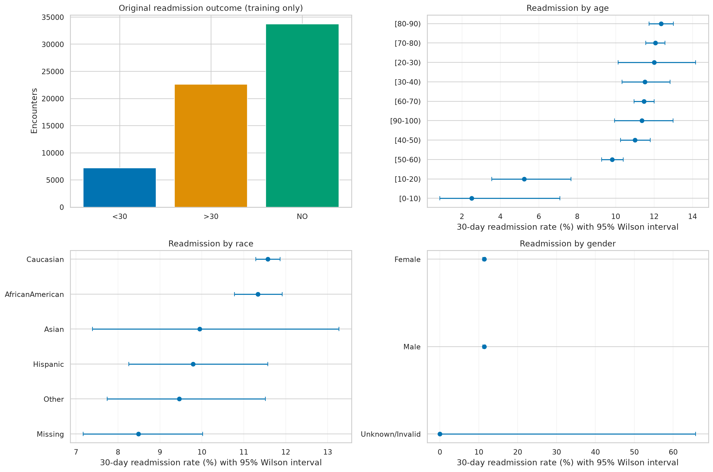
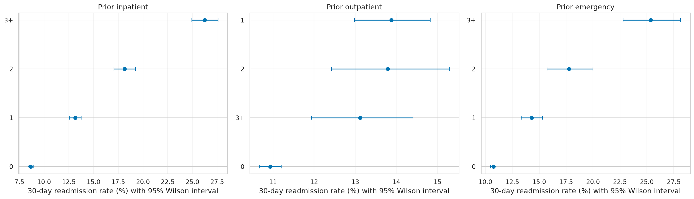
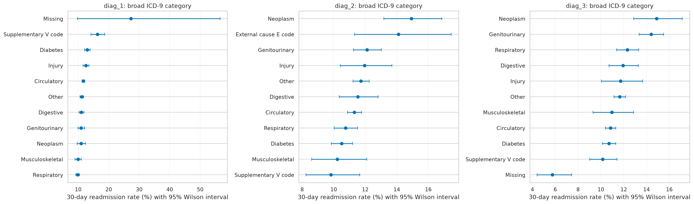

Additional [admission](figures/eda_admissions.png), [clinical predictor](figures/eda_clinical_predictors.png), [missingness-pattern](figures/eda_missingness_patterns.png) and [numeric association](figures/eda_numeric_associations.png) figures accompany [group rates](reports/training_group_readmission_rates.csv), [numeric summaries](reports/numeric_descriptive_statistics.csv) and [categorical summaries](reports/categorical_statistics.csv). Descriptive group-rate Wilson intervals assume independent encounters and do not adjust for repeated patients; the primary test uncertainty analysis below uses patient clusters.

## 5. Methodology and Data Leakage Prevention

### Clinical eligibility

Exclude deaths, hospice discharges and incomplete/ongoing admissions before splitting. Death precludes later readmission; hospice has a different care objective. Do not relabel their outcomes as successful predictions. Excluded: **2,447** encounters.

| Discharge code | Prespecified reason | Excluded encounters |
| --- | --- | ---: |
| 9 | Admitted as an inpatient to this hospital: not a completed discharge | 21 |
| 11 | Expired | 1,642 |
| 12 | Still a patient: not a completed discharge | 3 |
| 13 | Hospice at home | 399 |
| 14 | Hospice in a medical facility | 372 |
| 19 | Expired at home | 8 |
| 20 | Expired in a medical facility | 2 |
| 21 | Expired, location unknown | 0 |

Other transfers are retained, with continuity-of-care ambiguity acknowledged. Discharge disposition is available at the specified prediction time and remains a categorical predictor.

### Separation and preprocessing

| Partition | Encounters | Patients | Positive prevalence |
| --- | ---: | ---: | ---: |
| Train | 63,566 | 44,880 | 11.38% |
| Validation | 15,892 | 11,137 | 11.38% |
| Test | 19,861 | 13,963 | 11.38% |

`StratifiedGroupKFold` reserves approximately 20% for test and 20% of the remaining development population for validation. A separate **three-fold stratified patient-group CV** operates inside training. All pairwise holdout overlaps and all CV patient overlaps are **zero**; [split manifest](reports/split_manifest.json) records aggregate counts and encounter-list hashes without exporting IDs.

Every fitted pipeline owns clinical derivation, missingness removal, median numeric imputation (with missing indicators), constant categorical imputation and training-learned infrequent-category one-hot encoding. Logistic Regression additionally standardises numeric values. Validation/test transforms never refit these stages. Race, gender and payer are excluded from primary predictors; race/gender remain available for audit. This does not guarantee fairness or remove their proxies.

Prespecified derived features include age-band midpoint, broad ICD-9 diagnosis groups, previous-visit totals, active diabetes medication indicators, dose-change counts, and laboratory measurement flags. Raw diagnosis codes are replaced by these broad groups. The original IDs and target are excluded from predictors. Learned missingness exclusions: **weight**; selected model encoded dimension: **185**.

## 6. Machine Learning Models

1. **DummyClassifier**: training prior, to quantify performance without discrimination.
2. **Logistic Regression**: interpretable sparse baseline; L2 regularisation and optional balanced weights.
3. **Random Forest**: nonlinear interactions; bounded depth/leaf size and optional balanced-subsample weights.
4. **XGBoost**: CPU histogram boosting, regularisation and optional training negative/positive class weighting.

Fixed seed **42**, two CPU threads, serial outer search. Each nontrivial model has **four prespecified candidate configurations**, evaluated by three-fold training-only `RandomizedSearchCV` (this budget covers each four-candidate space). Both weighted and unweighted alternatives are evaluated; no SMOTE, synthetic samples, or test-set resampling is used. This is a modest, transparent search, not an exhaustive tuning claim. See [training search](reports/training_search.json) and individual `reports/cv_*.csv` files for every candidate's actual scores.

The winning candidate for each family is refit on training only. The validation set chooses a threshold maximising **F2**, with the highest threshold breaking ties. This is a prespecified illustrative preference for recall, not a clinical cost function. Selection and thresholds are saved before test predictions in [selection.json](reports/selection.json). Models are not subsequently refit on validation, which preserves the validation threshold/probability relationship.

## 7. Model Evaluation and Comparison

Rows are ordered by **training CV average precision**, not test performance. Bold identifies the model chosen before test evaluation. Test threshold metrics use each model's frozen validation threshold. Average precision (AP) is the step-weighted PR summary, not trapezoidal PR area.

| Model | CV AP | Test ROC-AUC | Test AP | Precision | Sensitivity | Specificity | F1 | Brier | Threshold |
| --- | ---: | ---: | ---: | ---: | ---: | ---: | ---: | ---: | ---: | ---: |
| **XGBoost** | 0.2206 | 0.6693 | 0.2259 | 0.1582 | 0.7279 | 0.5028 | 0.2600 | 0.0960 | 0.0936 |
| Random Forest | 0.2143 | 0.6602 | 0.2114 | 0.1521 | 0.7491 | 0.4637 | 0.2528 | 0.0972 | 0.0996 |
| Logistic Regression | 0.2106 | 0.6603 | 0.2136 | 0.1487 | 0.7425 | 0.4542 | 0.2478 | 0.0968 | 0.0889 |
| Dummy | 0.1138 | 0.5000 | 0.1138 | 0.1138 | 1.0000 | 0.0000 | 0.2043 | 0.1008 | 0.1138 |

For XGBoost, the test confusion counts are **TP 1,645, FP 8,751, FN 615, TN 8,850**. At this operating point, many flagged encounters do not have a recorded 30-day readmission. Workload and missed events require a service-specific utility/capacity analysis before choosing an operational threshold.

Selected-model 95% percentile confidence intervals, resampling **patients** with replacement:

| Metric | 95% interval | Bootstrap resamples |
| --- | --- | ---: |
| roc_auc | 0.6583–0.6820 | 200 |
| average_precision | 0.2110–0.2454 | 200 |
| brier_score | 0.0930–0.0993 | 200 |

These are conditional on the trained model, cohort and single held-out split; they do not incorporate retraining uncertainty or prove superiority over other models.

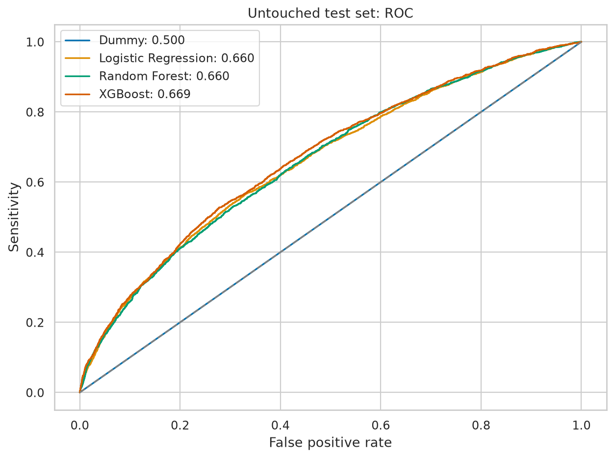
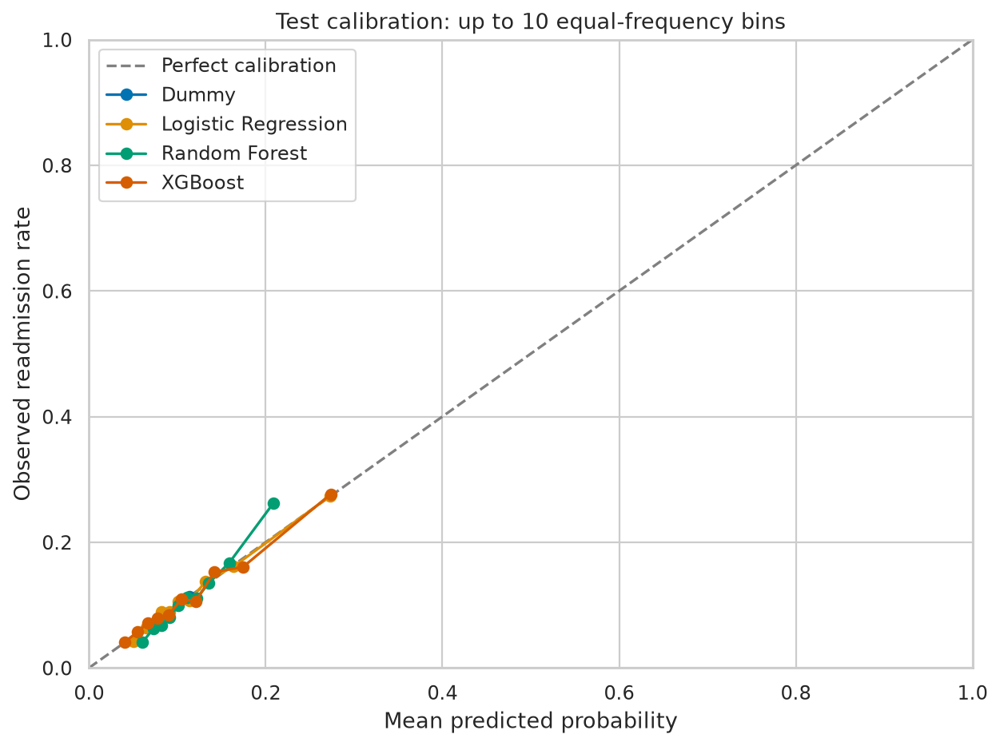
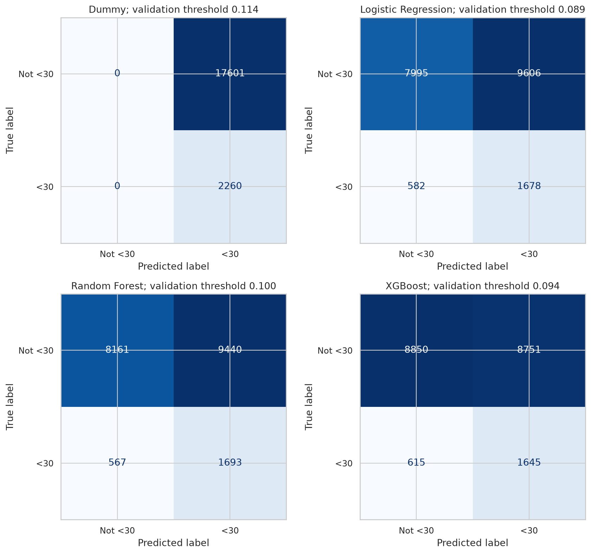

The reliability plot uses up to ten equal-frequency bins. Brier score and ten-bin equal-width expected calibration error are retained in [test_metrics.json](reports/test_metrics.json). Weighted training can shift probability calibration. No probability recalibration was fitted to test data, and these outputs should not be assumed calibrated for clinical risk communication.

## 8. Explainability and SHAP Results

SHAP explains **80 fixed random real test encounters**, after model selection. Additivity and reconstructed probabilities are checked against the fitted prediction pipeline. XGBoost explanations use the original sparse feature matrix; converting absent entries to explicit dense zeros can change its predictions. Dense values are used only to label plots. Contributions are in **log odds**, with one-hot encoded categories shown explicitly.

The five highest mean absolute contributions in this sample were:

- `numeric__number_inpatient`: mean absolute SHAP 0.2421.
- `categorical__discharge_disposition_id_1`: mean absolute SHAP 0.1715.
- `numeric__prior_visit_total`: mean absolute SHAP 0.1101.
- `numeric__active_diabetes_medications`: mean absolute SHAP 0.0615.
- `numeric__time_in_hospital`: mean absolute SHAP 0.0581.

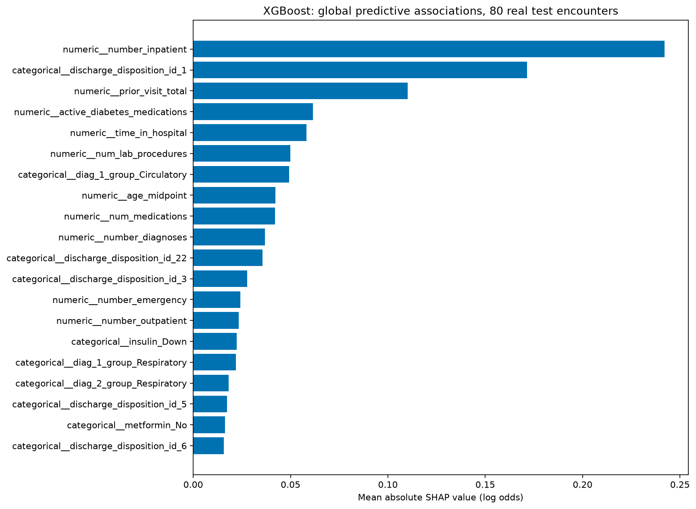
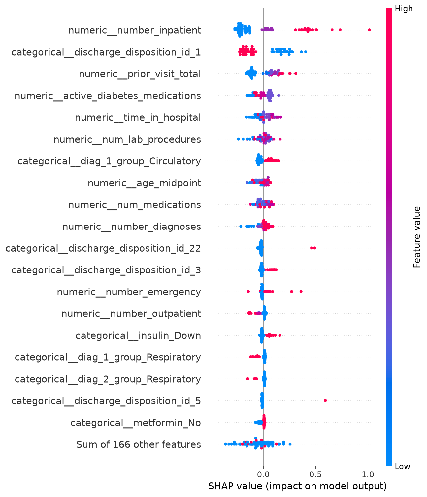
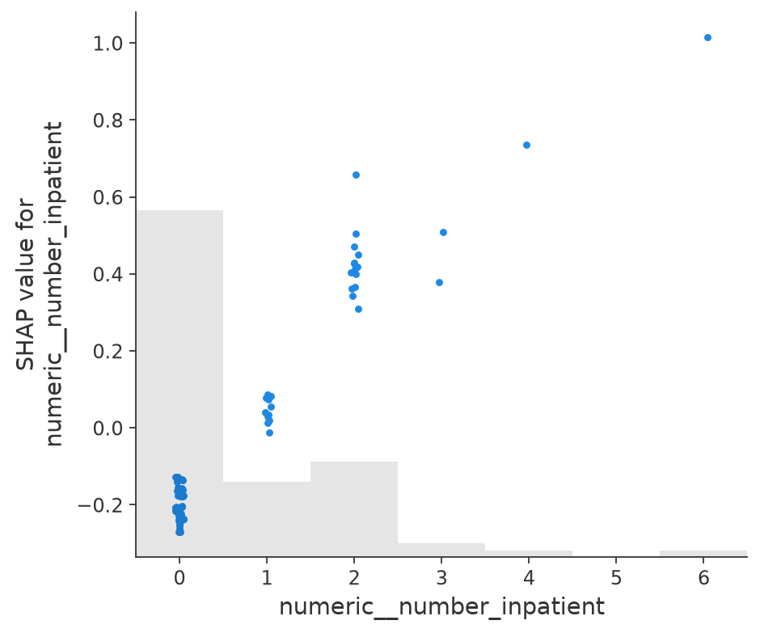

These describe the model's predictive associations. Correlated clinical variables distribute attribution, one-hot categories are not independent interventions, and medication associations do **not** identify treatment benefit or harm. This small explanation sample is not a population-wide causal analysis. Full values: [importance CSV](reports/shap_feature_importance.csv).

## 9. Clinical Interpretation

Interpret discharge context and prior utilisation as potential markers of complexity and care pathways. An outcome label may encode access to care and ascertainment as well as clinical status. A high score is not proof of preventability, negligence or a need for a particular intervention.

[Error analysis](reports/error_analysis.csv) compares real false-negative/false-positive groups using aggregate clinical summaries. [Subgroup evaluation](reports/test_subgroup_metrics.csv) audits age, recorded race/gender and discharge codes at the same frozen threshold. Discrimination is withheld for strata with fewer than 100 encounters or 20 observations of either class. These exploratory results are not a fairness certification, and exclusion of demographic predictors does not eliminate proxies.

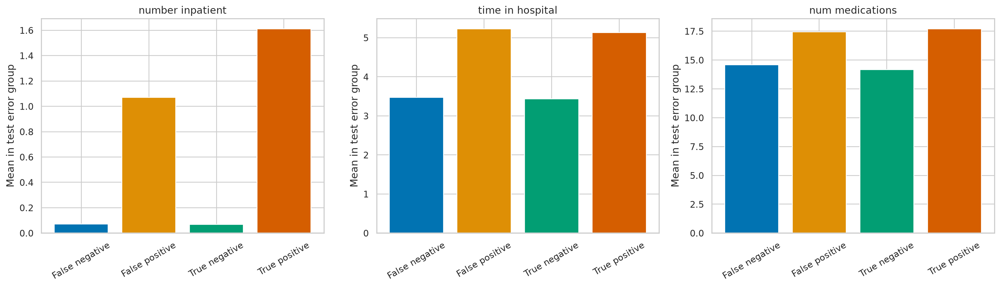
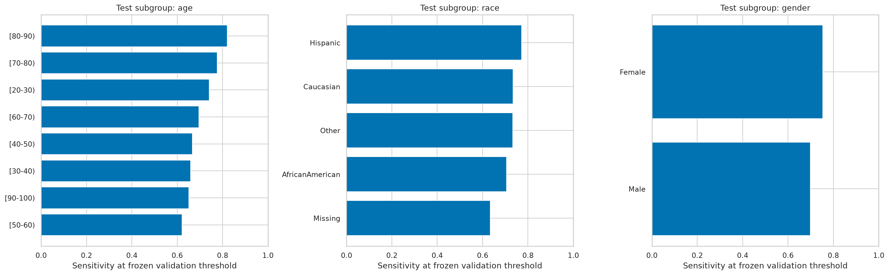

## 10. Limitations and Future Improvements

- US hospital data from **1999–2008** are not contemporary UK/NHS data. Coding, care pathways, population mix and treatment have changed; UK transportability is untested.
- No admission/discharge dates support temporal validation, precise follow-up assessment or verification of coding availability at the proposed prediction time. Patient separation is necessary but not equivalent to prospective validation.
- `NO` is no recorded readmission, not guaranteed absence of readmission. Readmissions elsewhere, censoring, death after discharge and transfer-related continuity may distort labels. The dataset cannot resolve all these issues.
- Encounter-level weighting gives frequent attenders greater influence; patient-level performance and alternative cohort definitions warrant sensitivity analysis.
- Extensive/informative missingness, coarse age bands and simplified ICD-9 groupings limit information. The cohort and feature choices are reasoned educational assumptions, not prospectively adjudicated criteria.
- Modest tuning, a single holdout and 200 patient bootstrap resamples give limited precision. Subgroups with sparse events are particularly uncertain. The test set must not be repeatedly used for redesign.
- Future work: nested/temporal and external validation, cohort/transfer sensitivity analyses, development-only calibration, patient-level outcome formulations, clinically elicited decision thresholds, net-benefit/capacity analysis and monitoring for drift.
- Before clinical use: contemporary NHS validation, information governance, equity assessment, clinical safety evaluation and prospective service evaluation are required. No patient benefit, clinical safety or regulatory readiness is claimed here.

## 11. Installation and Reproducibility Instructions

Python **3.11.17**, Linux x86_64, CPU. The complete **65-package** environment (excluding this editable project) is pinned with hashes in `requirements.lock`; `requirements.in` records direct versions and `pyproject.toml` declares package dependencies. Install [uv](https://docs.astral.sh/uv/) first if needed.

```bash
git clone https://github.com/bitfatmonkey/hospital-readmission-prediction.git
cd hospital-readmission-prediction
# Check out the portfolio feature branch until the PR is merged.
git checkout feature/discharge-readmission-portfolio
uv python install 3.11.17
uv venv --python 3.11.17 .venv
uv pip sync requirements.lock --python .venv/bin/python --require-hashes --only-binary :all:
uv pip install --python .venv/bin/python --no-deps --no-build-isolation -e .
source .venv/bin/activate
export MPLBACKEND=Agg OMP_NUM_THREADS=2 OPENBLAS_NUM_THREADS=2
python -m hospital_readmission.data
python -m hospital_readmission.run
python -m hospital_readmission.notebooks --execute
python -m hospital_readmission.documentation --check
python -m pytest -q
python -m hospital_readmission.verify
```

In the prepared Codex machine, activate with `source /workspace/hospital-readmission-environment/activate.sh`. A complete run measures models, writes aggregate reports/figures and saves ignored local artifacts. `python -m hospital_readmission.run --resume` reuses model checkpoints only when the training code, configuration, dependency lock and split fingerprint match; it does not claim retraining occurred. Notebooks use a temporary writable kernel registration and execute against the real outputs. Expected runtime is machine-dependent; the measured run took **12.2 minutes**. Seeds, package versions and patient manifests are fixed; elapsed times, notebook metadata and small floating-point differences can vary between systems.

Local automated validation: **35 tests passed**, 0 failures, 0 errors, 0 skipped. Three executed notebooks accompany the analysis. [GitHub Actions](.github/workflows/ci.yml) is configured for dependency checking, real-data tests, report/README consistency and archive loading; a hosted CI run must be assessed separately from local validation.

```text
hospital_readmission/  loader, cohort, clinical features, splitting, models, evaluation,
                       EDA, SHAP, inference, notebook execution and result verification
notebooks/             executed EDA, feature/leakage and modelling notebooks
tests/                 real-data, pipeline, splitting, metric and report regressions
data/raw/              unchanged original ZIP only; no extracted duplicates
reports/               aggregate measured outputs, audit manifests and uncertainty
figures/               generated EDA, performance, calibration, error and SHAP figures
artifacts/             ignored locally fitted models (never load untrusted joblib files)
```

Use `hospital_readmission.predict.predict_readmission` with a locally trained trusted artifact for reusable inference. Model files, patient-level predictions, extracted/processed data and caches are ignored. No secrets or new patient-level datasets are committed. Seed/configuration, package versions, source fingerprint and validation completion are recorded in [run_metadata.json](reports/run_metadata.json).

The README's measured results are generated from reports by `python -m hospital_readmission.documentation`; `--check` fails on any mismatch. Code changes affecting modelling require a new experiment and refreshed outputs. Publication of a cloud environment, a Git push and hosted CI are separate operations from the measured local run.
